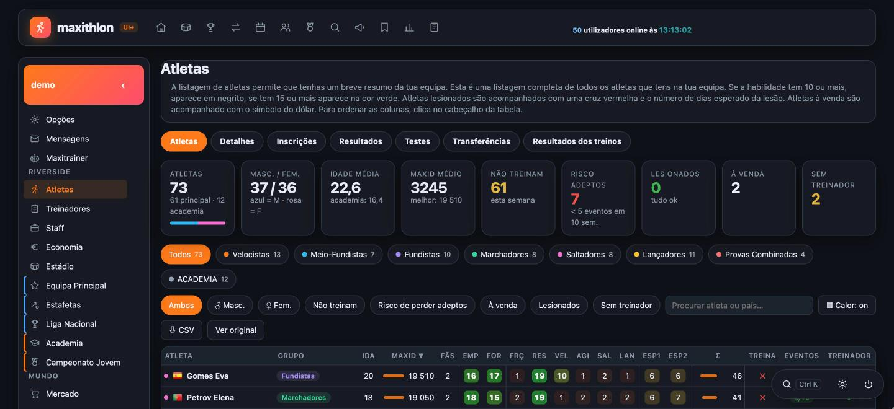
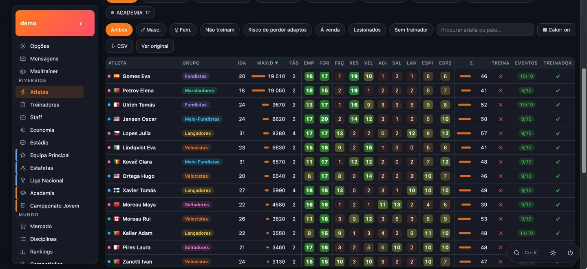
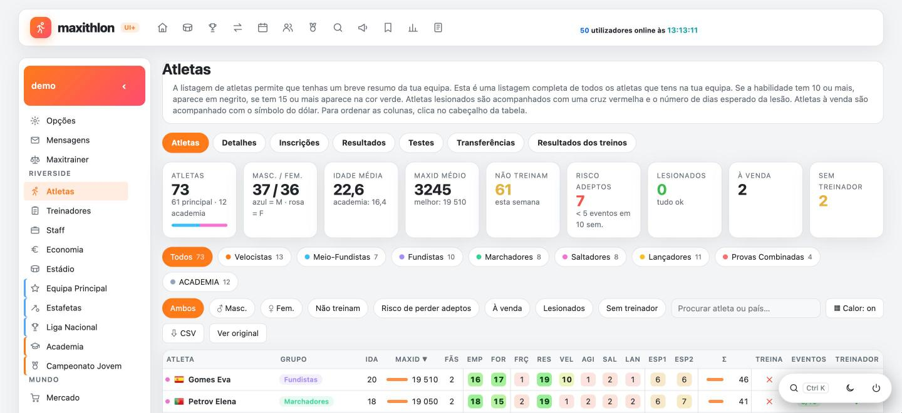
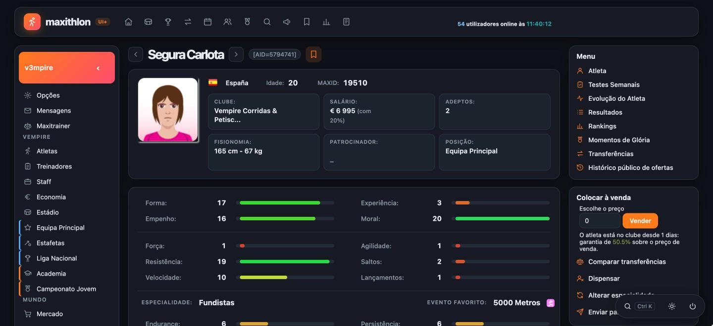
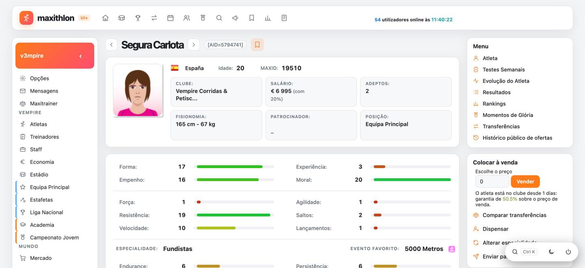
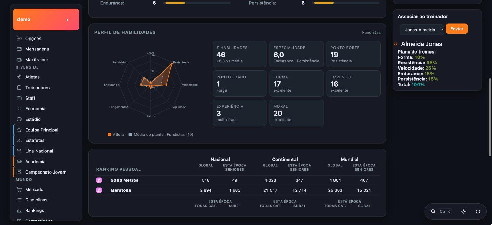
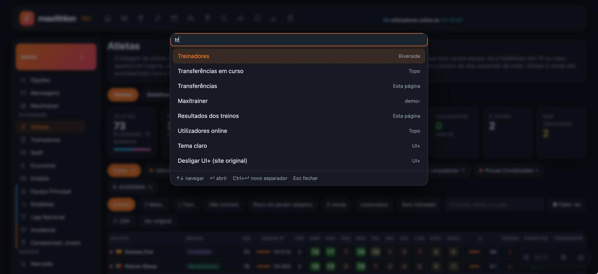

# Maxithlon UI+

A userscript that gives [Maxithlon](https://maxithlon.com), the online athletics management game, a modern interface: dark and light themes, a wide layout, SVG icons, a roster dashboard, an athlete skill radar and a command palette.

It only changes how pages **look**. It never submits forms, makes extra requests or automates anything in the game.

## Screenshots

| | |
|---|---|
|  |  |
| **Roster table** with the 0–20 heat map | **Light theme** |
|  |  |
| **Athlete page**: profile and skills | **Athlete page**, light theme |
|  |  |
| **Skill radar** compared with the roster average | **Command palette** (`Ctrl+K`) |

## Features

- **Dark / light theme** with an adaptive dark mode that also fixes the colors of content loaded later via AJAX.
- **Wide, flexible layout** instead of the original fixed-width columns. On narrow windows the right column moves under the content.
- **Theme colors everywhere**: the site's legacy olive, teal, magenta and red text is mapped to the theme palette.
- **Collapsible page intros**: the long explanation at the top of each page shows one line until you expand it.
- **Command palette** (`Ctrl+K` or `/`): jump to any page in the menu, top bar or current page tabs. Recently used pages come first.
- **Roster dashboard** (`Athletes` page):
  - summary cards (gender split, average age and MAXID, athletes not training, fan risk, injuries, for sale, without coach);
  - filters by group, gender and status, plus search by name or country;
  - sortable table with a 0–20 heat map and the site's rise/drop markers;
  - CSV export of the current view (opens in Excel).
- **Athlete page** as cards (profile, skills, rankings, notes) with a **skill radar**: the 8 skills (6 base + 2 specialty) compared with your roster's average for that group. Full club names instead of the site's cut ones, once seen on another page.
- **Right column**: price and coach forms on one row, the coach's training plan as bars.
- **Event pictograms** (sprint, hurdles, jumps, throws…) in the athlete's gender color instead of the square images.
- **Skill bars** colored from red (0) to green (20).
- **Consistent SVG icons** for the menus, top bar and athlete actions.

## Languages

The script works with **any site language**. Game data (skill names, groups, tooltips) is read from the page itself, and parsing relies on page structure (column order, element position, CSS classes, image names), never on text.

UI+ works with the game in any language. Its own buttons and labels are available in English and Portuguese, picked from the site's language automatically (English is used for other languages). Translations live in the `I18N` object at the top of the script. Pull requests for more languages are welcome.

## Installation

1. Install a userscript manager such as [Tampermonkey](https://www.tampermonkey.net/) or [Violentmonkey](https://violentmonkey.github.io/).
2. Install the script from **[Greasy Fork](https://greasyfork.org/scripts/606889-maxithlon-ui)** (recommended) or straight from GitHub: [`maxithlon-ui.user.js` (raw)](https://raw.githubusercontent.com/luismiguelopes/maxithlon-ui/main/maxithlon-ui.user.js).
3. Open Maxithlon. Updates are picked up automatically from wherever you installed it.

Use the dock in the bottom-right corner to switch themes, open the palette or turn UI+ off (going back to the original site).

## Development

Everything lives in a single file, `maxithlon-ui.user.js`: plain JavaScript, no build step, no dependencies and no remote assets.

- Bump `@version` on every change, otherwise userscript managers won't pick up the update.
- Wrap each page module in `try/catch` inside `start()`, so a site change only breaks that module. Errors are logged with the `[UI+]` prefix.
- Check the syntax with `node --check maxithlon-ui.user.js`.
- Test in both themes on at least: home, Athletes list, an athlete page, market and finances.

See [ROADMAP.md](ROADMAP.md) for planned work.

## Disclaimer

This is an unofficial fan project, not affiliated with or endorsed by Maxithlon.

## License

[MIT](LICENSE)
